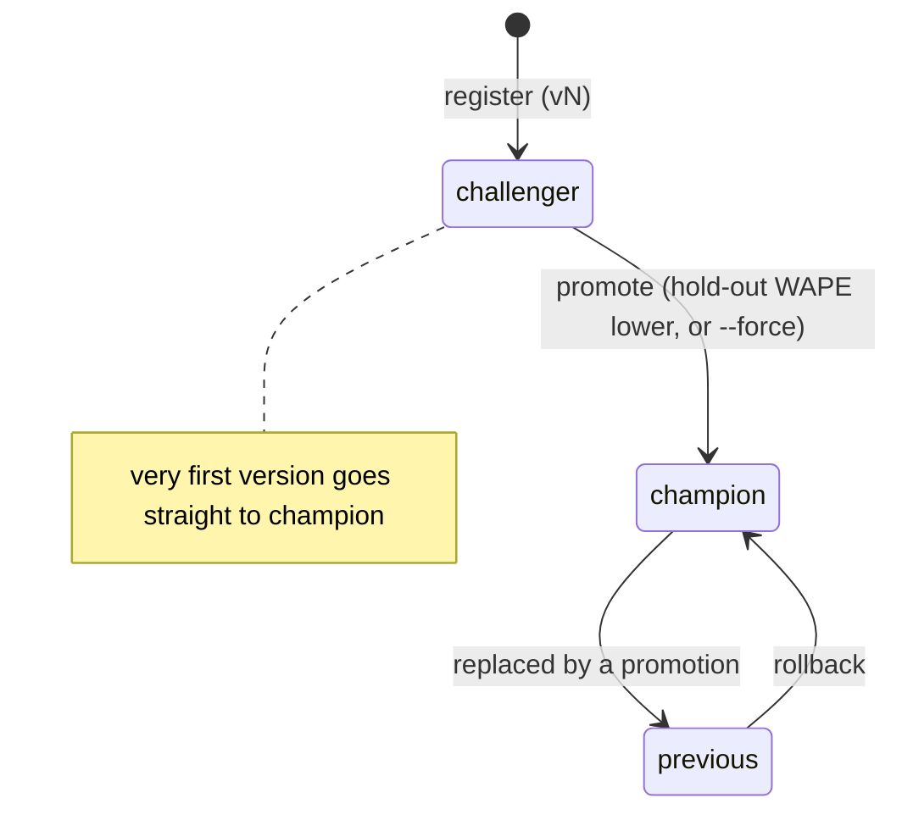

# 5. Model Registry: register, promote, roll back

**Code:** [`registry.py`](../src/pharma_forecast/registry.py),
[`predict.py`](../src/pharma_forecast/predict.py) ·
**Test:** [`tests/test_pipeline.py`](../tests/test_pipeline.py)

## What problem it solves

Retraining produces a new candidate every time. We need to (a) keep every
version, (b) serve exactly one of them, (c) only switch when the new one is
better, and (d) switch back quickly if something goes wrong after a release.

## Aliases

MLflow deprecated fixed stages (`Staging`/`Production`) in favour of
**aliases**, named pointers to a version. This project uses three:

| Alias | Meaning |
|---|---|
| `@champion` | the version `predict` loads (`models:/pharma-demand-forecaster@champion`) |
| `@challenger` | latest registered candidate, waiting for promotion |
| `@previous` | the champion replaced by the last promotion (rollback target) |

## Flow



```bash
pharma-forecast register            # last trained run -> vN @challenger
pharma-forecast promote             # compares holdout_xgboost_wape_mean
pharma-forecast promote --force     # override the metric gate
pharma-forecast rollback            # @champion -> @previous
pharma-forecast rollback --version 3
pharma-forecast status              # table of versions/aliases/metrics
```

### Promotion gate

`promote` reads `holdout_xgboost_wape_mean` from each version's training run
and only moves `@champion` if the challenger is lower. Before moving it, the
current champion is saved as `@previous`.

Caveat: two versions trained on data with different end dates have different
hold-out windows, so their WAPEs are not strictly comparable. This gate is a
simple safety check, not a statistical test. A production system would score
both versions on the same recent window (or run a shadow period, see
`predict --alias challenger`).

In the benchmark run ([benchmarks.md](benchmarks.md)) this gate did real
work: the Ray-Tune-tuned model had a better CV WAPE (0.0904 vs 0.0960) but a
worse hold-out WAPE (0.0960 vs 0.0910), so `promote` rejected it and the
default-params version stayed champion.

### Rollback

`rollback` points `@champion` back at `@previous` and tags the version it
rolled back from with `rolled_back=true`, so it is visible in the UI why that
version lost the alias. No files are copied and nothing is retrained:
consumers resolve the alias the next time they load the model.

## Test

`test_train_register_promote_rollback_predict` uses a throw-away SQLite store
and asserts the aliases after every step:

1. v1 registered → `{champion: v1}`
2. worse v2 registered → `{champion: v1, challenger: v2}`; `promote` refuses
3. `promote --force` → `{champion: v2, previous: v1}`
4. `rollback` → `{champion: v1}`; `predict` serves v1

## Prediction

`predict` builds features from the full history and keeps the last row per
ingredient, so only what is known at the end of that day is used. It loads
`@champion` and writes `forecast_7`, `forecast_15`, `forecast_30` in grams,
plus the model version that produced them.
